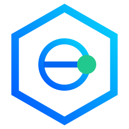

ALI LABS X is an independent technology engineering company. We build bespoke software, private AI and infrastructure around real organizational needs.

**You define the problem. We engineer the solution.**

## The thinking behind our products

<table>
<tr><td width="90" align="center"></td><td><b>NOVA BOTS</b> What if AI worked like a well-run team? Bots with clear roles share context, hand work along and leave the final decision to a person. <a href="mailto:Jahanzaib@alilabsx.com?subject=NOVA%20BOTS%20private%20demo%20request">Request a private demo</a> &nbsp; <a href="https://github.com/Ali-Labs-X/nova-bots">Read the source code</a></td></tr>
<tr><td width="90" align="center"></td><td><b>NOVA</b> What if you could see how an AI agent does its work? NOVA gives the agent its own computer, so every step can be inspected. <a href="mailto:Jahanzaib@alilabsx.com?subject=NOVA%20private%20demo%20request">Request a private demo</a> &nbsp; <a href="https://github.com/Ali-Labs-X/nova">Read the source code</a></td></tr>
<tr><td width="90" align="center"></td><td><b>LOCO</b> What if local AI told you the truth about its limits? LOCO checks memory before it loads a model. Open source under Apache 2.0. <a href="mailto:Jahanzaib@alilabsx.com?subject=LOCO%20private%20demo%20request">Request a private demo</a> &nbsp; <a href="https://github.com/Ali-Labs-X/loco">Read the source code</a></td></tr>
<tr><td width="90" align="center"></td><td><b>STORELOOM</b> What if a storefront could grow without losing its shape? Design and operations in one system, with separate data for each site. <a href="mailto:Jahanzaib@alilabsx.com?subject=STORELOOM%20private%20demo%20request">Request a private demo</a></td></tr>
</table>

## Problems we solve

We build the answer as infrastructure the client owns. It can be branded for the client or built from zero.

Team chat, calendar and booking, knowledge base, file storage, customer platform, help desk, project workspace, business dashboards, workflow automation, video meetings, single sign-in, private AI assistant, online store and system monitoring.

## What we do

Bespoke software · Enterprise systems · AI and intelligent systems · Private infrastructure · Edge and distributed computing · Privacy and governance · Technology consultancy

## How we work

Discover → Architect → Engineer → Deploy → Validate → Enable

## Company

ALI LABS X (PRIVATE) LIMITED, Lahore, Pakistan. [CUIN 0366968](https://leap.secp.gov.pk/#/verify-company-info/0366968), registered with the Securities and Exchange Commission of Pakistan.

Open-source projects stay under the licence in each repository.
