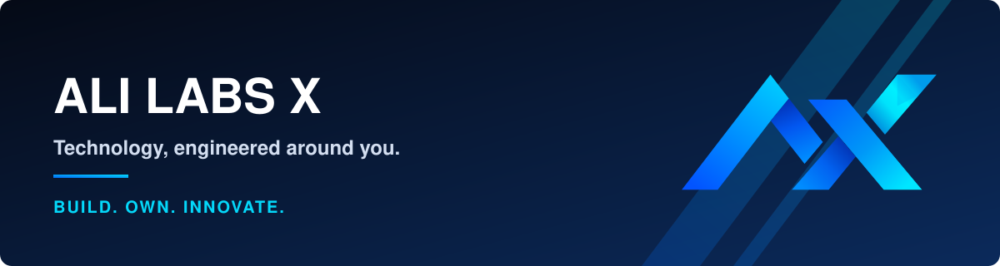

ALI LABS X is an independent technology engineering company. We build bespoke software, private AI and infrastructure around real organizational needs.

**You define the problem. We engineer the solution.**

## Products

| Product | What it does | Links |
|---|---|---|
| **NOVA BOTS** | A team of long-lived AI bots with roles that share chats and hand work to each other. Cloud or self-hosted. | [Open](https://bots.alilabsx.com) · [Code](https://github.com/Ali-Labs-X/nova-bots) |
| **NOVA** | The agent's computer: watch an AI agent work through its files, terminal, editor and browser. | [Open](https://nova.alilabsx.com) · [Code](https://github.com/Ali-Labs-X/nova) |
| **LOCO** | Open-source local inference lab: one OpenAI-compatible endpoint, predictable routing, and a GPU memory check before a model loads. | [Code](https://github.com/Ali-Labs-X/loco) |
| **STORELOOM** | Commerce platform with storefronts, a visual editor, apps and custom domains. Private and commercial. | [Ask for a demo](mailto:Jahanzaib@alilabsx.com?subject=STORELOOM%20demo) |

## What we do

Bespoke software · Enterprise systems · AI and intelligent systems · Private infrastructure · Edge and distributed computing · Privacy and governance · Technology consultancy

## How we work

Discover → Architect → Engineer → Deploy → Validate → Enable

## Company

ALI LABS X (PRIVATE) LIMITED, Lahore, Pakistan. [CUIN 0366968](https://leap.secp.gov.pk/#/verify-company-info/0366968), registered with the Securities and Exchange Commission of Pakistan.

Open-source projects stay under the licence in each repository.
